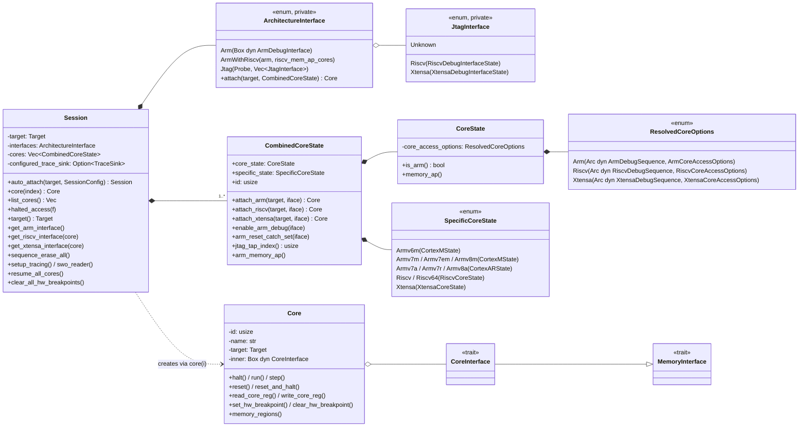
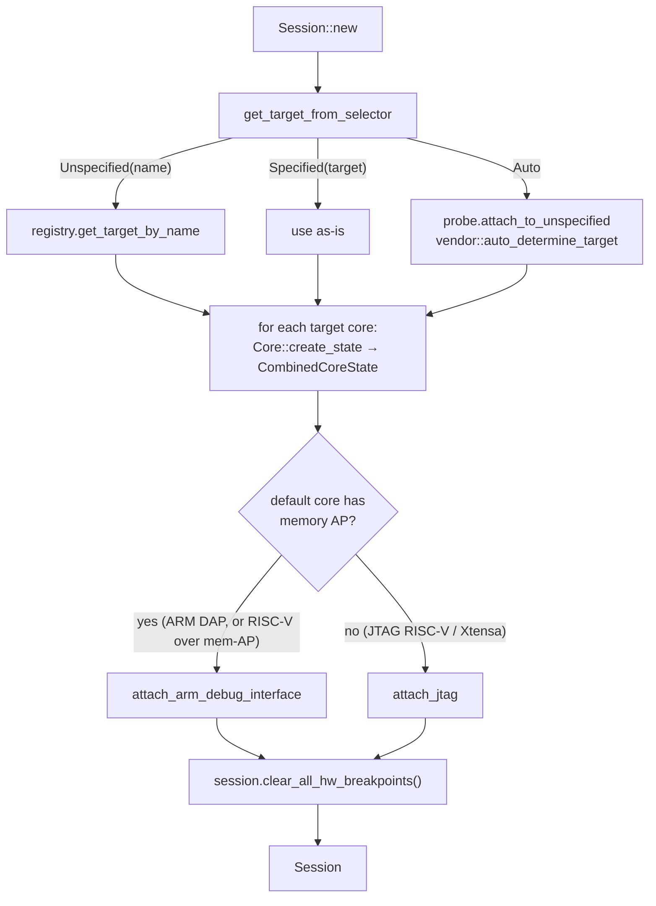
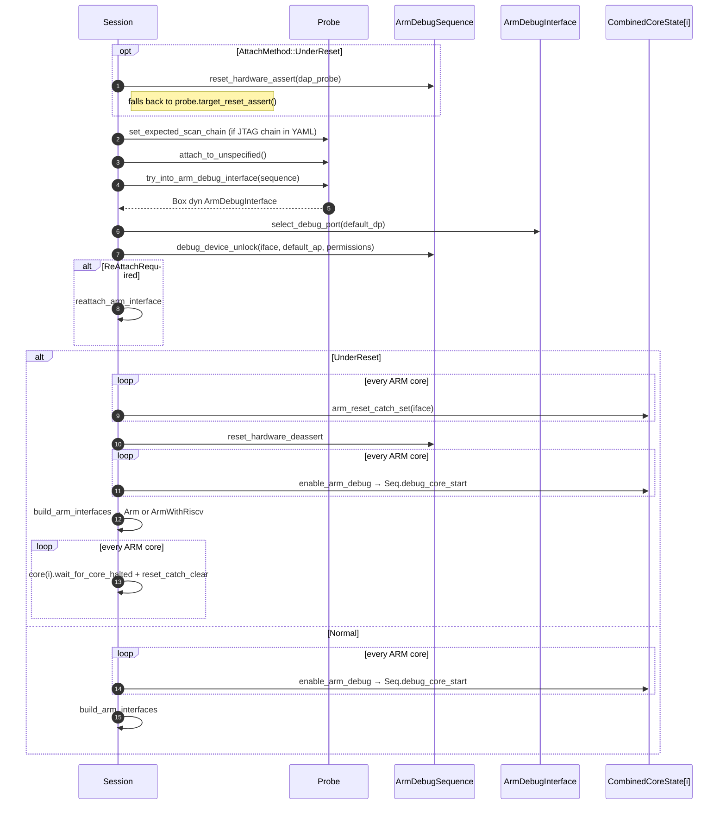
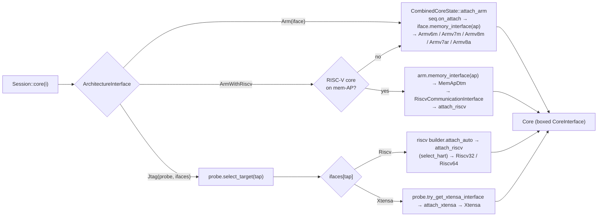
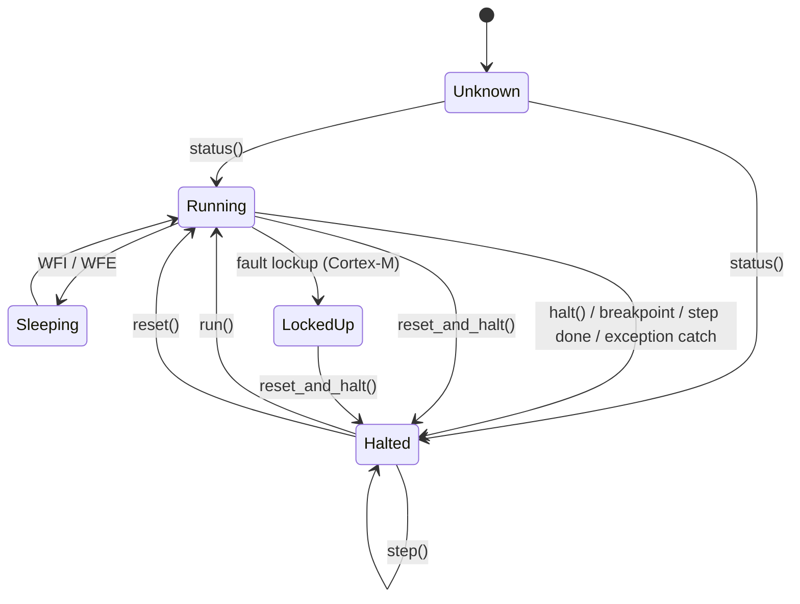

# 01 — Session and Core

Sources: [session.rs](../../src/session.rs), [core.rs](../../src/core.rs),
[core/core_state.rs](../../src/core/core_state.rs), [core/registers.rs](../../src/core/registers.rs),
[core/core_status.rs](../../src/core/core_status.rs), [memory/mod.rs](../../src/memory/mod.rs).

## 1. Responsibilities

| Type | Lifetime | Role |
|---|---|---|
| `Session` | Long-lived; the only handle users should store | Owns the `Target`, the architecture interface (which owns the `Probe`) and per-core state. Can be shared across threads as `Arc<FairMutex<Session>>`. |
| `SessionConfig` | Transient | Speed, `WireProtocol`, `Permissions` for `Session::auto_attach`. |
| `Permissions` | Copied into session | Gate for irreversible operations (`erase_all`). |
| `CombinedCoreState` (`pub(crate)`) | Lives inside `Session.cores` | Per-core persistent state: id, resolved access options + debug sequence, architecture-specific cached state. |
| `Core<'probe>` | Short-lived borrow of `Session` | Public façade around `Box<dyn CoreInterface + 'probe>`. Recreated by every `Session::core(i)` call. |
| `CoreInterface` | Trait | Architecture-neutral core control API; extends `MemoryInterface`. |

## 2. Static structure

### `CombinedCoreState` in detail

`CombinedCoreState` (in [core_state.rs](../../src/core/core_state.rs)) is the glue
between persistent per-core data and the transient `Core` handle:

* **`core_state.core_access_options: ResolvedCoreOptions`** — created by
  `ResolvedCoreOptions::new(target, options)` in [core.rs](../../src/core.rs). It pairs
  the YAML core access options (memory AP / debug base / CTI base, hart id, JTAG TAP)
  with the debug sequence `Arc`. If the target's `debug_sequence` doesn't match the
  core's architecture (e.g. RP235x RISC-V cores on an ARM-sequenced family) the
  default sequence for that architecture is used.
* **`specific_state: SpecificCoreState`** — architecture-specific cache that must
  outlive a `Core` borrow, for example:
  * `CortexMState`: `initialized`, `hw_breakpoints_enabled`, `current_state: CoreStatus`,
    `fp_present`, pending semihosting command
  * `CortexARState`: `is_64_bit`, `register_cache`, `fp_reg_count`, ...
  * `RiscvCoreState`: breakpoint state, `pc_written`, `fp_present`, ...
  * `XtensaCoreState`: `enabled`, `breakpoint_set`, `pc_written`, ...
* **`id`** — index into `Target.cores`.

The `attach_*` methods consume the architecture communication interface plus
`&mut specific_state` and construct the concrete core driver
(`Armv6m`, `Armv7m`, `Armv8m`, `Armv7ar`, `Armv8a`, `Riscv32`, `Riscv64`, `Xtensa`),
boxing it into a `Core`.

## 3. Creating a session

`Probe::attach(...)` → `Session::new(probe, TargetSelector, AttachMethod, Permissions, &Registry)`.

### 3.1 ARM / DAP path (`attach_arm_debug_interface`)

### 3.2 JTAG path (`attach_jtag`) — RISC-V and Xtensa

1. Apply the YAML scan chain (`set_scan_chain` when `force_scan_chain`, otherwise
   `set_expected_scan_chain`), then `probe.attach_to_unspecified()`.
2. Determine the TAP count (from scan chain, or highest `jtag_tap_index` + 1).
3. For every core, initialise its TAP slot once:
   * RISC-V → `probe.try_get_riscv_interface_builder()`, `create_state()`,
     `attach_auto(...)`, `enter_debug_mode()` → `JtagInterface::Riscv(state)`
   * Xtensa → `JtagInterface::Xtensa(XtensaDebugInterfaceState::default())`
   * Mixing architectures on the same TAP is rejected.
4. Build `ArchitectureInterface::Jtag(probe, interfaces)`.
5. For RISC-V targets call `RiscvDebugSequence::on_connect` for every core.

## 4. Obtaining a `Core`

`Session::core(i)` borrows `self` mutably and calls
`ArchitectureInterface::attach(&target, &mut cores[i])`:

Errors `ArmError::CoreDisabled`, `XtensaError::CoreDisabled` and
`RiscvError::HartUnavailable` are mapped to `Error::CoreDisabled(i)` so callers
can retry later.

> The docs on `Session::core` stress: *never store the `Core` handle for long*.
> All persistent state lives in the `Session`; the first call runs init sequences,
> subsequent calls are cheap.

## 5. `CoreInterface` contract

`CoreInterface: MemoryInterface` ([core.rs](../../src/core.rs)) — implemented by
`Armv6m`, `Armv7m`, `Armv8m`, `Armv7ar`, `Armv8a`, `Riscv32`/`Riscv64`
(`RiscvCore`), `Xtensa`, and by `Core` itself.

| Group | Methods |
|---|---|
| Run control | `wait_for_core_halted`, `core_halted`, `status`, `halt`, `run`, `reset`, `reset_and_halt`, `step` |
| Registers | `read_core_reg`, `write_core_reg`, `registers`, `program_counter`, `frame_pointer`, `stack_pointer`, `return_address` |
| Breakpoints | `available_breakpoint_units`, `hw_breakpoints`, `enable_breakpoints`, `set_hw_breakpoint`, `clear_hw_breakpoint`, `hw_breakpoints_enabled` |
| Introspection | `architecture`, `core_type`, `instruction_set`, `endianness`, `fpu_support`, `floating_point_register_count`, `is_64_bit` |
| Debug events | `reset_catch_set`, `reset_catch_clear`, `enable_vector_catch`, `disable_vector_catch`, `debug_core_stop`, `spill_registers` |

`MemoryInterface` ([memory/mod.rs](../../src/memory/mod.rs)) provides
`read_word_{8,16,32,64}`, `read_{8,16,32,64}`, `read`, the write equivalents,
`supports_native_64bit_access`, `supports_8bit_transfers`, `flush`, and batched
`execute_memory_operations`. `Core` gets it via the `CoreMemoryInterface` adapter.

## 6. Core status model

`CoreStatus::Halted(HaltReason)` carries the reason (`Breakpoint(BreakpointCause)`,
`Multiple`, `Exception`, `Watchpoint`, `Step`, `Request`, `External`, `Unknown`). A semihosting
request is reported as a breakpoint cause, see
[06-rtt-semihosting-trace.md](./06-rtt-semihosting-trace.md).

## 7. Concurrency model

* `Session` is `Send` (asserted at compile time in `session.rs`).
* Multi-stakeholder use (GDB + RTT + flashing in `probe-rs-tools`) wraps the
  session in a mutex; each stakeholder acquires it, calls `core(i)`, performs an
  atomic operation and drops the borrow.
* `Session::halted_access(f)` halts all running cores, executes `f`, then resumes
  the cores that were running before.
* `Drop for Session` clears all hardware breakpoints and calls `debug_core_stop()`
  on every enabled core (disabled cores are skipped); failures are only logged.
