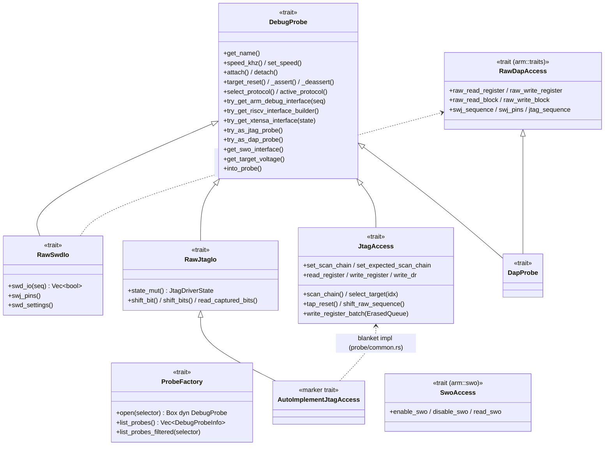
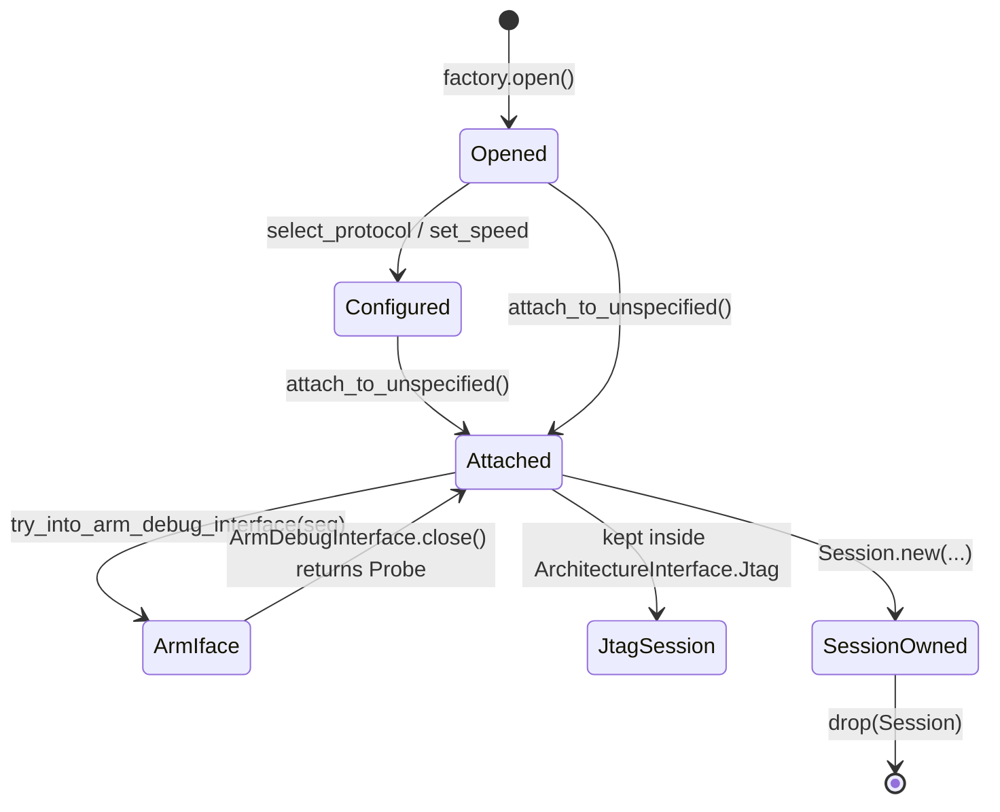
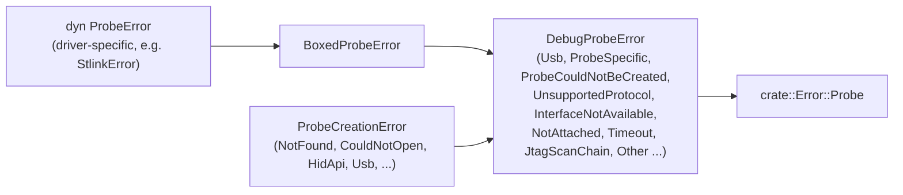

# 02 — Probe layer

Sources: [probe.rs](../../src/probe.rs), [probe/list.rs](../../src/probe/list.rs),
[probe/selector.rs](../../src/probe/selector.rs), [probe/common.rs](../../src/probe/common.rs),
[probe/queue.rs](../../src/probe/queue.rs), [probe/usb_util.rs](../../src/probe/usb_util.rs),
driver folders under [probe/](../../src/probe/).

## 1. Responsibilities

* Enumerate connected debug probes (USB via `nusb`/`hidapi`, serial ports, network for Glasgow/BMP).
* Open a probe from a `DebugProbeSelector` (`VID:PID[:serial]`, interface).
* Configure wire protocol (`WireProtocol::Swd` / `Jtag`), speed and reset lines.
* Expose **capabilities** to the architecture layer: an ARM debug interface, a
  RISC-V DTM builder, an Xtensa interface, a JTAG chain, SWO.

## 2. Discovery and opening

```mermaid
flowchart LR
    subgraph Registry["static DRIVERS: global list of dyn ProbeFactory"]
        BMP["BlackMagicProbeFactory"]
        CMSIS["CmsisDapFactory"]
        FTDI["FtdiProbeFactory"]
        STL["StLinkFactory"]
        JL["JLinkFactory"]
        WCH["WchLinkFactory"]
        SIF["SifliUartFactory"]
        GL["GlasgowFactory"]
        CH["Ch347UsbJtagFactory"]
        PLUG["... plugin factories<br/>(register_probe_factory)"]
    end

    Lister["Lister<br/>(Box dyn ProbeLister)"] --> APL["AllProbesLister"]
    APL -->|"list_probes()"| Registry
    Registry -->|"Vec of DebugProbeInfo"| Info["DebugProbeInfo<br/>identifier, vid, pid, serial,<br/>interface, probe_factory"]
    Info -->|"open()"| Fac["probe_factory.open(selector)"]
    Fac --> DP["Box dyn DebugProbe"] --> Probe["Probe { inner, attached }"]
```

* `Lister::new()` uses `AllProbesLister`; `Lister::with_lister()` lets tools inject a
  custom/limited lister (e.g. the RPC server's `LimitedLister`, test mocks).
* `register_probe_factory` (crate-private, used by [plugin.rs](../../src/plugin.rs))
  appends extra drivers such as `probe-rs-espressif`'s ESP USB-JTAG and
  `probe-rs-linux`'s GPIO / spidev bit-bangers.

## 3. Trait hierarchy

### Blanket implementations ("polyfills")

| Provided | Requirement | Location |
|---|---|---|
| `JtagAccess` | `T: AutoImplementJtagAccess` (i.e. `RawJtagIo`) | [probe/common.rs](../../src/probe/common.rs) — implements TAP state machine, IR/DR shifting, scan-chain detection on top of bit-level IO |
| `RawDapAccess` | `T: DebugProbe + RawSwdIo + JtagAccess` | [architecture/arm/traits/polyfill.rs](../../src/architecture/arm/traits/polyfill.rs) — implements ADI SWD/JTAG-DP transfers (ACK/WAIT/retry, parity) from raw bits |

This lets a bit-level driver (FTDI, J-Link, BMP, CH347, Linux GPIO) gain full ARM
DAP support by implementing only `RawSwdIo` + `RawJtagIo`.

## 4. Driver capability matrix

Derived from `impl ... for ...` blocks in each driver folder:

| Driver | `DebugProbe` | `RawSwdIo` | `RawJtagIo` → `JtagAccess` | native `JtagAccess` | `RawDapAccess` | own `ArmDebugInterface` | `SwoAccess` |
|---|---|---|---|---|---|---|---|
| CMSIS-DAP (v1 HID / v2 bulk) | ✔ | | ✔ | | ✔ native DAP commands | | ✔ |
| SEGGER J-Link | ✔ | ✔ | ✔ | | polyfill | | ✔ |
| FTDI (MPSSE) | ✔ | ✔ | ✔ | | polyfill | | |
| Black Magic Probe | ✔ | ✔ | ✔ | | polyfill | ✔ (remote protocol) | ✔ |
| CH347 USB-JTAG | ✔ | ✔ | ✔ | | polyfill | | |
| Glasgow | ✔ | | | | ✔ native | | |
| ST-Link | ✔ | | | | | ✔ `StlinkArmDebug` (high-level API) | ✔ |
| WCH-Link | ✔ | | | ✔ | | | |
| SiFli UART | ✔ | | | | | ✔ `SifliUartArmDebug` | ✔ |
| `FakeProbe` (tests) | ✔ | | | | | ✔ `FakeArmInterface` | |

Two strategies exist for ARM:

1. **Generic ADI stack** — the probe supplies `RawDapAccess` (natively or via
   polyfill) and `try_get_arm_debug_interface` returns an
   `ArmCommunicationInterface` which implements DP/AP logic in probe-rs.
2. **Probe-managed ADI** — probes with high-level firmware (ST-Link, BMP remote,
   SiFli) return their own `ArmDebugInterface` implementation.

## 5. Probe lifecycle

`Probe` public API (selection): `attach`, `attach_with_registry`,
`attach_under_reset[_with_registry]`, `attach_to_unspecified[_under_reset]`,
`select_protocol`, `set_speed`, `target_reset[_assert|_deassert]`, `detach`,
`try_into_arm_debug_interface`, `try_get_riscv_interface_builder`,
`try_get_xtensa_interface`, `try_as_jtag_probe`, `try_as_dap_probe`,
`get_swo_interface[_mut]`, `get_target_voltage`.

`AttachMethod` is `Normal` (default) or `UnderReset` (hold nRESET while connecting —
needed when firmware disables debug pins or sleeps).

## 6. JTAG command batching

[probe/queue.rs](../../src/probe/queue.rs) defines a typed `Queue<E>` of
`JtagCommand`s (register writes / DR shifts with result transformers) and its
type-erased form `ErasedQueue`. Drivers execute it via
`JtagAccess::write_register_batch(&ErasedQueue)`, returning a
`DeferredResultSet<CommandResult>` indexed by `DeferredResultIndex`; partial
failures are reported as `BatchExecutionError` carrying the results gathered so
far. The default implementation executes commands one by one (and logs a
performance warning). The RISC-V JTAG DTM relies heavily on batching to
pipeline debug module accesses.

## 7. Errors

