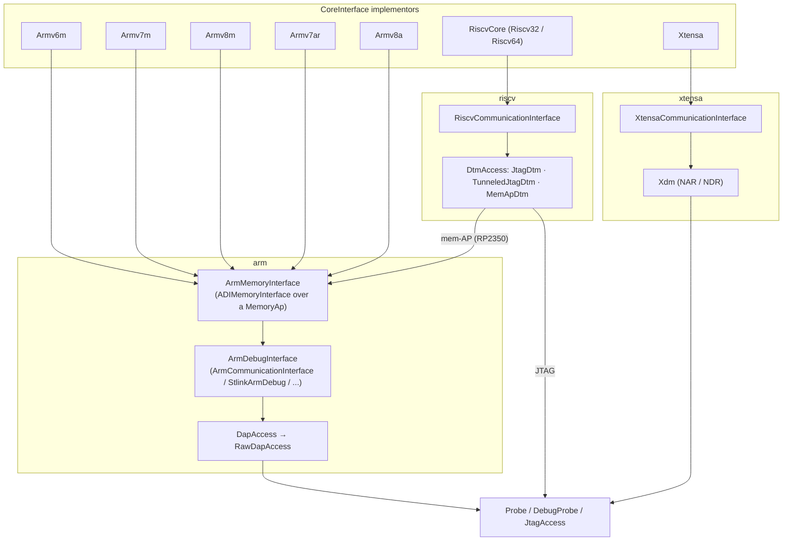
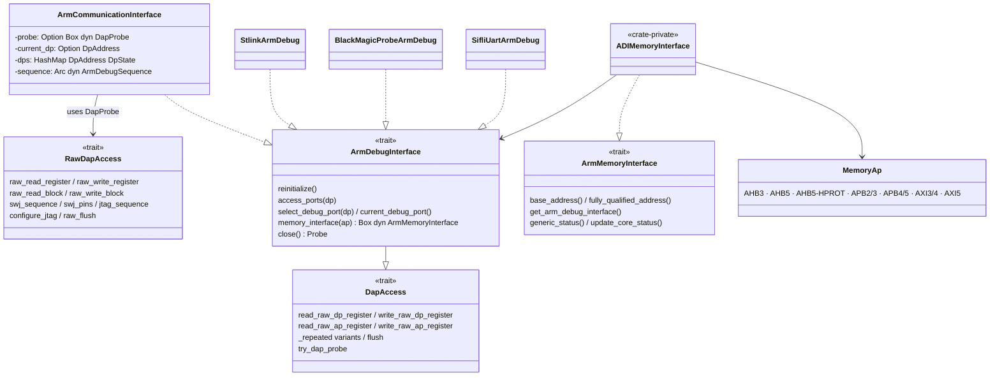
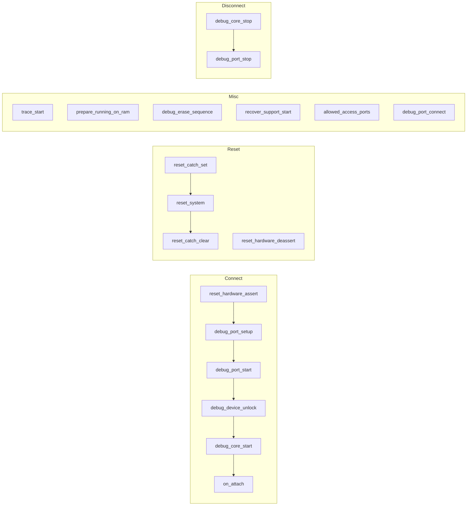
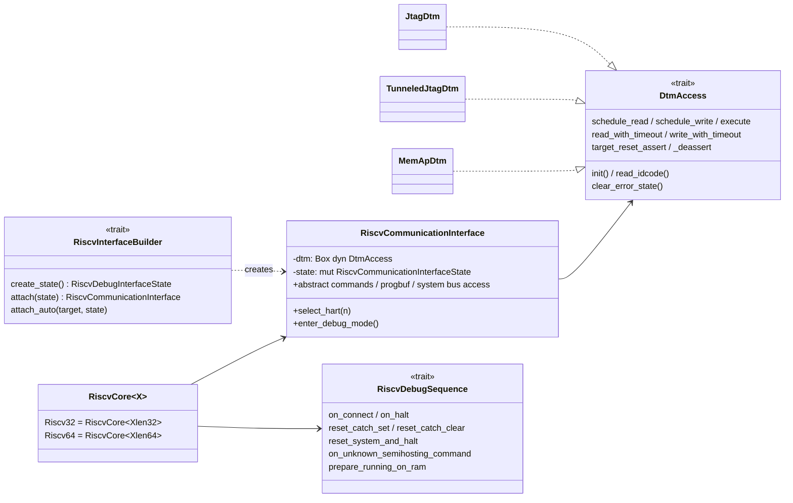
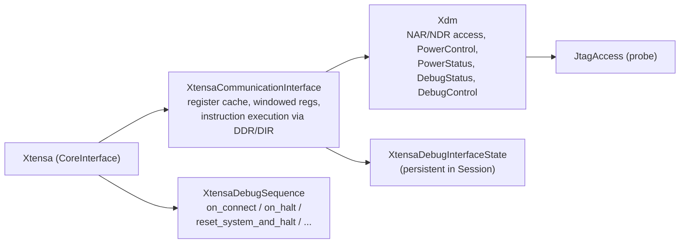
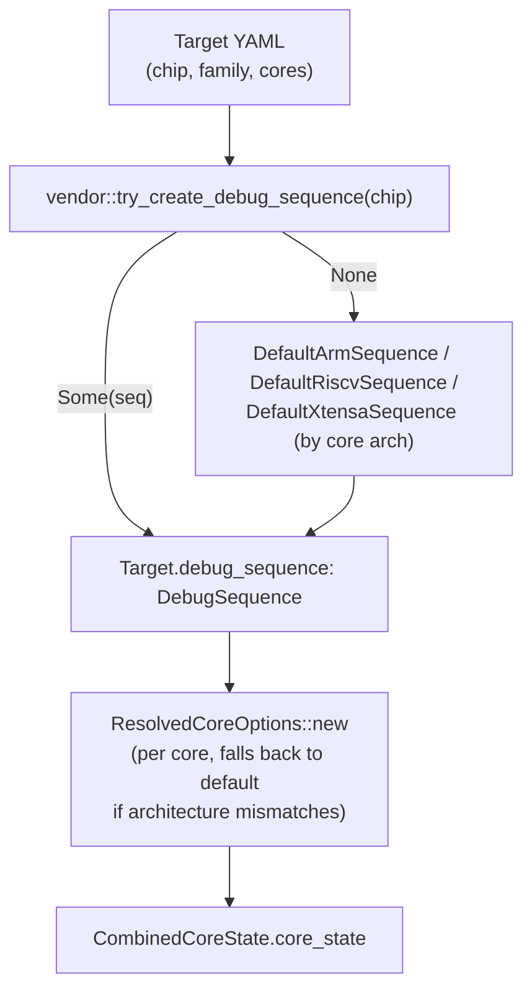

# 03 — Architecture layer (ARM, RISC-V, Xtensa)

Sources: [architecture/arm/](../../src/architecture/arm/mod.rs),
[architecture/riscv/](../../src/architecture/riscv/mod.rs),
[architecture/xtensa/](../../src/architecture/xtensa/mod.rs).

The architecture layer turns raw probe capabilities into **core drivers** that
implement `CoreInterface`. Each architecture has:

| Concern | ARM | RISC-V | Xtensa |
|---|---|---|---|
| Transport to debug logic | `ArmDebugInterface` (DP/AP) | `DtmAccess` (JTAG DTM, tunnelled JTAG, mem-AP DTM) | `Xdm` over JTAG (NAR/NDR) |
| Communication interface | `ArmCommunicationInterface` or probe-specific impl | `RiscvCommunicationInterface<'state>` | `XtensaCommunicationInterface<'probe>` |
| Persistent interface state | `DpState` map inside interface | `RiscvDebugInterfaceState` | `XtensaDebugInterfaceState` |
| Core drivers | `Armv6m`, `Armv7m`, `Armv8m`, `Armv7ar`, `Armv8a` | `RiscvCore<X: XlenMode>` = `Riscv32` / `Riscv64` | `Xtensa` |
| Per-core cache | `CortexMState`, `CortexARState` | `RiscvCoreState` | `XtensaCoreState` |
| Chip customisation hook | `ArmDebugSequence` | `RiscvDebugSequence` | `XtensaDebugSequence` |
| Error type | `ArmError` | `RiscvError` | `XtensaError` |

---

## 1. ARM (ADIv5 / ADIv6, CoreSight)

### 1.1 Layering

### 1.2 Addressing

* `DpAddress` — `Default` or `Multidrop(targetsel)` (SWD multi-drop, e.g. RP2040).
* `ApAddress` — `V1(u8)` (ADIv5 APSEL) or `V2(ApV2Address)` (ADIv6 hierarchical
  address; root memory interface in [ap/v2/](../../src/architecture/arm/ap/v2/mod.rs)).
* `FullyQualifiedApAddress { dp, ap }` — what the YAML core description and
  `CombinedCoreState::arm_memory_ap()` resolve to.
* DP registers (`Ctrl`, `Abort`, `SelectV1/V3`, `DPIDR`, `TARGETID`, `BASEPTR0/1`, ...)
  and AP registers are strongly typed via `DpRegister` / `ApRegister` traits and
  `bitfield!` macros.

### 1.3 Discovery: ROM tables and CoreSight components

[memory/romtable.rs](../../src/architecture/arm/memory/romtable.rs) walks ROM tables
(`RomTable`, `RomTableEntry`, `ComponentId`, `PeripheralID`) to build a
`CoresightComponent` tree. `read_chip_info_from_rom_table` produces `ArmChipInfo`
(JEP106 manufacturer + part) used for **auto-detection** (see
[04-targets-vendors-plugins.md](./04-targets-vendors-plugins.md)).

[component/](../../src/architecture/arm/component/mod.rs) implements drivers for
DWT, ITM, TPIU, SWO, TMC (ETB/ETF), trace funnel and SCS, used by
`Session::setup_tracing`.

### 1.4 Core drivers

| Driver | File | Cores | Mechanism |
|---|---|---|---|
| `Armv6m` | [core/armv6m.rs](../../src/architecture/arm/core/armv6m.rs) | Cortex-M0/M0+/M1 | DHCSR/DCRSR/DCRDR, BPU |
| `Armv7m` | [core/armv7m.rs](../../src/architecture/arm/core/armv7m.rs) | Cortex-M3/M4/M7 (v7-M, v7E-M) | DHCSR, FPB, DEMCR vector catch |
| `Armv8m` | [core/armv8m.rs](../../src/architecture/arm/core/armv8m.rs) | Cortex-M23/M33/M55/M85 | v8-M debug registers (DHCSR, FPB, DEMCR) |
| `Armv7ar` | [core/armv7ar.rs](../../src/architecture/arm/core/armv7ar.rs) | Cortex-A/R v7 | memory-mapped debug regs at `debug_base`, instruction injection via ITR |
| `Armv8a` | [core/armv8a.rs](../../src/architecture/arm/core/armv8a.rs) | Cortex-A v8 (AArch32/AArch64) | debug regs + **CTI** (`cti_base`) for halt/restart, instruction injection |

Shared helpers live in [core/cortex_m.rs](../../src/architecture/arm/core/cortex_m.rs),
[core/instructions.rs](../../src/architecture/arm/core/instructions.rs) and the
register definitions under [core/registers/](../../src/architecture/arm/core/registers).

### 1.5 `ArmDebugSequence` — CMSIS debug-description hooks

[arm/sequences.rs](../../src/architecture/arm/sequences.rs) mirrors the
Open-CMSIS-Pack debug description. Every method has a spec-compliant default
(`DefaultArmSequence`); vendors override only what they need.

---

## 2. RISC-V (Debug Spec 0.13 / 1.0)

* **DTM transports** ([dtm/](../../src/architecture/riscv/dtm/mod.rs)):
  * `JtagDtm` — standard JTAG DTM (`dtmcs`, `dmi`) using batched JTAG queues;
    `JtagDtmBuilder` implements `RiscvInterfaceBuilder` for any `JtagAccess` probe.
  * `TunneledJtagDtm` — DTM reached through a BSCAN tunnel in another TAP (SiFive scheme,
    equivalent to OpenOCD's `riscv use_bscan_tunnel`), e.g. RISC-V soft cores in FPGAs.
  * `MemApDtm` — DM mapped behind an ARM MEM-AP (RP2350 Hazard3 cores); used by the
    `ArchitectureInterface::ArmWithRiscv` variant.
* **Memory access** — `MemoryAccessMethod` / `RiscvBusAccess` choose between
  program buffer, abstract memory commands or the system bus (`sbcs`, `sbaddress*`,
  `sbdata*`), cached per access width in `MemoryAccessConfig`.
* **Harts** — one DM may expose several harts; `CombinedCoreState::attach_riscv`
  calls `select_hart(options.hart_id)`.

## 3. Xtensa (ESP32 family etc.)

* [xdm.rs](../../src/architecture/xtensa/xdm.rs) speaks the Xtensa Debug Module
  over JTAG (Nexus registers, power control).
* [communication_interface.rs](../../src/architecture/xtensa/communication_interface.rs)
  implements halt/resume, register access by injecting instructions
  ([arch/instruction](../../src/architecture/xtensa/arch)), memory access,
  breakpoints (`IBreakEn`), single-step (`ICount`).
* [register_cache.rs](../../src/architecture/xtensa/register_cache.rs) caches
  registers while halted; windowed registers are spilled with `spill_registers`.
* Concrete ESP sequences live in the `probe-rs-espressif` plugin crate.

## 4. Debug sequence selection

`DebugSequence` is `Arm(Arc<dyn ArmDebugSequence>)`,
`Riscv(Arc<dyn RiscvDebugSequence>)` or `Xtensa(Arc<dyn XtensaDebugSequence>)`
([config/target.rs](../../src/config/target.rs)).
