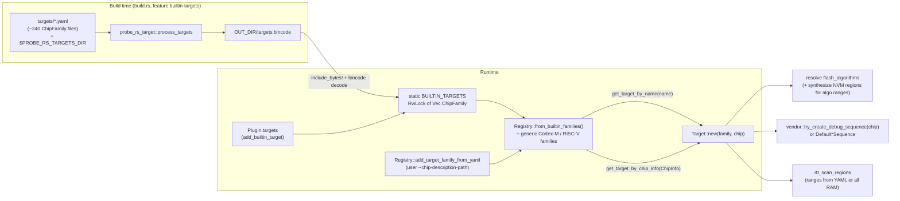
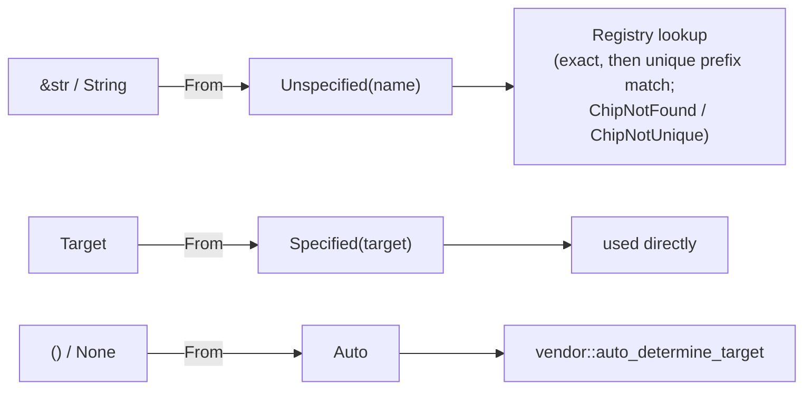
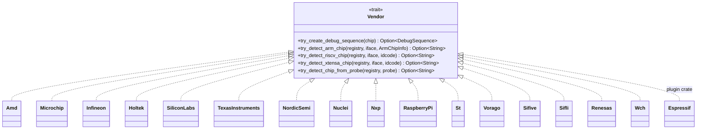
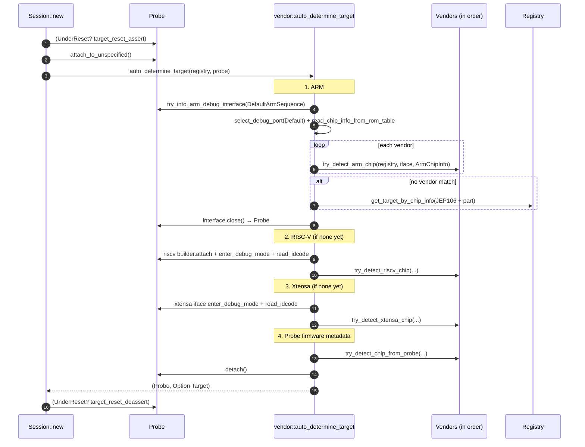
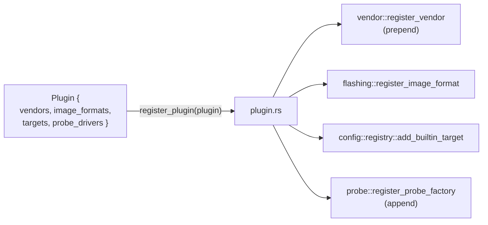

# 04 — Targets, vendors and plugins

Sources: [config/](../../src/config/mod.rs) ([target.rs](../../src/config/target.rs),
[registry.rs](../../src/config/registry.rs), [chip_info.rs](../../src/config/chip_info.rs)),
[vendor/](../../src/vendor/mod.rs), [plugin.rs](../../src/plugin.rs),
[build.rs](../../build.rs), [targets/](../../targets), and the `probe-rs-target` crate.

## 1. From YAML to `Target`

### `Target` (resolved, runtime form)

| Field | Meaning |
|---|---|
| `name` | Chip name (e.g. `nRF52840_xxAA`) |
| `cores: Vec<probe_rs_target::Core>` | name, `CoreType`, `CoreAccessOptions` (ARM: AP, debug/CTI base, JTAG TAP; RISC-V: hart id, TAP; Xtensa: TAP) |
| `flash_algorithms: Vec<RawFlashAlgorithm>` | CMSIS flash algorithm blobs and metadata |
| `memory_map: Vec<MemoryRegion>` | `Ram`, `Nvm`, `Generic` regions (with core visibility, alias flag, access flags) |
| `debug_sequence: DebugSequence` | `Arm` / `Riscv` / `Xtensa` sequence `Arc` |
| `rtt_scan_regions: ScanRegion` | Where to search for an RTT control block |
| `jtag: Option<Jtag>` | Scan chain description, `force_scan_chain` flag |
| `default_format` | Default image format name (e.g. `idf` for ESP) |
| `source` | `BuiltIn`, `Generic` or `External` |

`Target::flash_loader()` creates an empty `FlashLoader` for this memory map (see
[05-flashing.md](./05-flashing.md)). Mixed-architecture targets are rejected
(`Target::architecture()` asserts all cores share an architecture).

### `TargetSelector`

## 2. Vendors

* Vendors are stored in `static VENDORS: LazyLock<RwLock<Vec<&'static dyn Vendor>>>`.
* `register_vendor` **prepends**, so plugin vendors override built-in ones.
* Each vendor module (e.g. [vendor/st/](../../src/vendor/st/mod.rs),
  [vendor/nordicsemi/](../../src/vendor/nordicsemi/mod.rs)) matches chips by name
  and returns specialised sequences, e.g. `stm32_armv7`, `stm32h7`, `stm32n6`,
  `nrf52`, `nrf53`, `nrf54l`, `nrf91`, `rp2040`/`rp235x`, NXP `nxp_armv6m`/`nxp_armv7m`/
  `nxp_armv8m`/`mcx`, Microchip `atsam`/`mec17xx`, Silabs `efm32xg1`/`efm32xg2`, etc.

### Typical things a vendor sequence does

| Need | Hook overridden |
|---|---|
| Multi-drop SWD / special DP power-up (RP2040) | `debug_port_setup`, `debug_port_start` |
| Unlock read-protected chip via mass erase (nRF APPROTECT, STM32 RDP, Atmel) | `debug_device_unlock`, `debug_erase_sequence` (requires `Permissions::allow_erase_all`) |
| Keep debug alive in low power (STM32 DBGMCU) | `debug_core_start`, `debug_core_stop` |
| Non-standard reset (AIRCR not enough, watchdog, boot ROM) | `reset_system`, `reset_catch_set` |
| Trace clock / pin muxing | `trace_start` |
| Remap memory before running from RAM | `prepare_running_on_ram` |
| Hide inaccessible APs | `allowed_access_ports` |

## 3. Chip auto-detection (`TargetSelector::Auto`)

Failure yields `Error::ChipNotFound(RegistryError::ChipAutodetectFailed)`.

## 4. Plugin system

Plugin crates in this workspace:

* **probe-rs-espressif** — registers vendor `Espressif` (chip detection, Xtensa and
  RISC-V sequences), probe driver `EspUsbJtagFactory`, image format `IdfLoaderFactory`
  (ESP-IDF), and its own bincode-embedded targets.
* **probe-rs-linux** — Linux GPIO (`linuxgpiod`) and spidev SWD bit-bang probe drivers.

Because all extension points are global registries, a plugin must be registered
**before** the first `Lister`/`Registry`/`Session` use that should see it.
