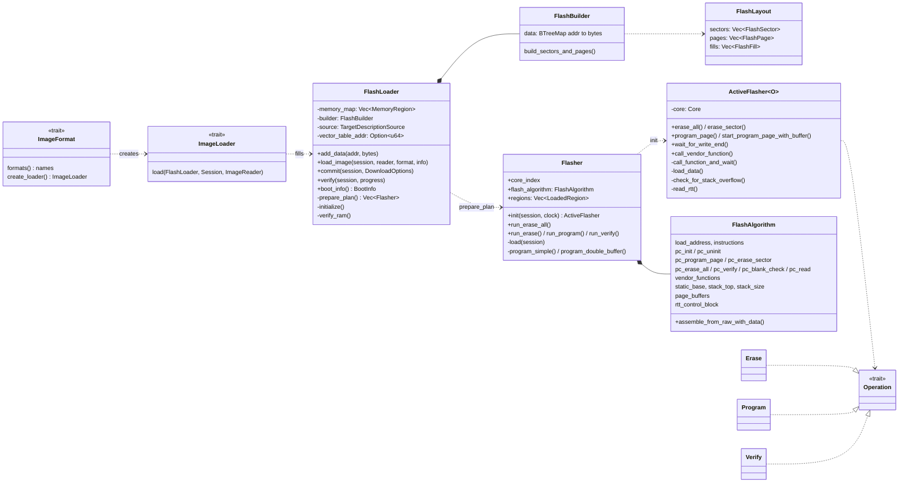
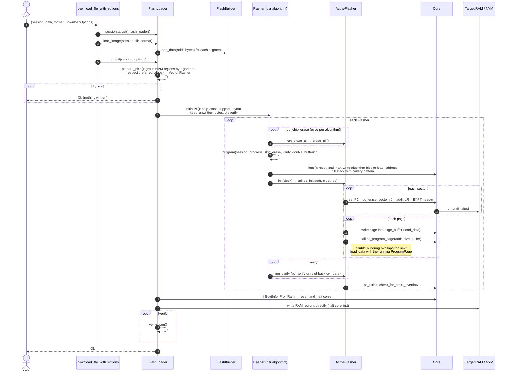
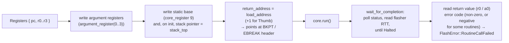

# 05 — Flashing

Sources: [flashing/](../../src/flashing/mod.rs) — [download.rs](../../src/flashing/download.rs),
[loader.rs](../../src/flashing/loader.rs), [builder.rs](../../src/flashing/builder.rs),
[flasher.rs](../../src/flashing/flasher.rs), [flash_algorithm.rs](../../src/flashing/flash_algorithm.rs),
[encoder.rs](../../src/flashing/encoder.rs), [erase.rs](../../src/flashing/erase.rs),
[progress.rs](../../src/flashing/progress.rs), [error.rs](../../src/flashing/error.rs).

## 1. Concept

probe-rs programs non-volatile memory by running **CMSIS-Pack flash algorithms**
on the target itself: the algorithm blob is copied into RAM, the core's PC/argument
registers are set to call `Init`, `EraseSector`, `ProgramPage`, ... and the core
is run until it hits a breakpoint placed in the blob header. RAM regions are
written directly through the debug interface.

## 2. Components

### Image formats

`static LOADERS` registry of `&'static dyn ImageFormat`:

| Format | Factory | Feature |
|---|---|---|
| ELF | `ElfLoaderFactory` | `builtin-formats` (uses `object`) |
| BIN (raw, base address + skip) | `BinLoaderFactory` | `builtin-formats` |
| Intel HEX | `HexLoaderFactory` | `builtin-formats` (uses `ihex`) |
| UF2 | `Uf2LoaderFactory` | `builtin-formats` (uses `uf2-decode`) |
| ESP-IDF | `IdfLoaderFactory` | registered by `probe-rs-espressif` plugin |

`flashing::image_format(name)` looks up a format by name;
`register_image_format` is used by the plugin system.

## 3. End-to-end flow

## 4. Calling a flash algorithm routine

`ActiveFlasher::call_function` (in [flasher.rs](../../src/flashing/flasher.rs)):

The blob header is architecture specific: Thumb `BKPT` (`0xBE00BE00`), A32 `BKPT`,
`HLT` for ARMv8-A/R, two `EBREAK` for RISC-V, none for Xtensa.

Optional features of the algorithm:

* **Flasher RTT** — if `rtt_control_block` is set and enabled, algorithm log output
  is read during `wait_for_completion`.
* **Stack overflow check** — stack area pre-filled with a pattern and checked afterwards.
* **Vendor functions** — extra named entry points callable via `call_vendor_function`.
* **Double buffering** — when ≥ 2 `page_buffers` exist and not disabled.

## 5. `DownloadOptions`

| Field | Effect |
|---|---|
| `progress: FlashProgress` | Callback receiving `ProgressEvent`s (`FlashLayoutReady`, `AddProgressBar`, `Started`, `Progress`, `Finished`, `Failed`, `DiagnosticMessage`; operations `Fill`/`Erase`/`Program`/`Verify`) |
| `keep_unwritten_bytes` | Read back and re-write sector contents not covered by the image |
| `dry_run` | Plan only, write nothing |
| `do_chip_erase` | Erase whole chip (per algorithm) instead of sectors |
| `skip_erase` | Assume flash already erased |
| `preverify` | Compare before writing; skip if identical |
| `verify` | Verify after programming |
| `disable_double_buffering` | Force simple programming |
| `preferred_algos` | Choose among multiple algorithms covering a region |

## 6. Other entry points

* [erase.rs](../../src/flashing/erase.rs) — `erase_all`, `erase` (address range) and `run_blank_check`, without programming.
* `Session::sequence_erase_all()` — debug-sequence-based mass erase
  (`ArmDebugSequence::debug_erase_sequence`), used for unlocking.
* [encoder.rs](../../src/flashing/encoder.rs) — `FlashEncoder` / `TransferEncoding`
  (`Raw` or `Miniz`-compressed transfer for algorithms that support it).
