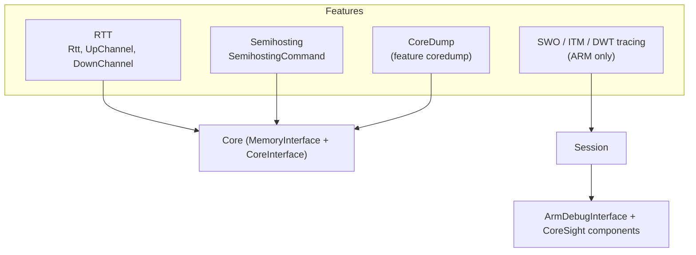
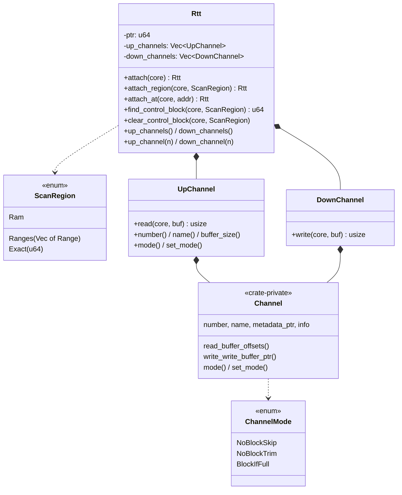
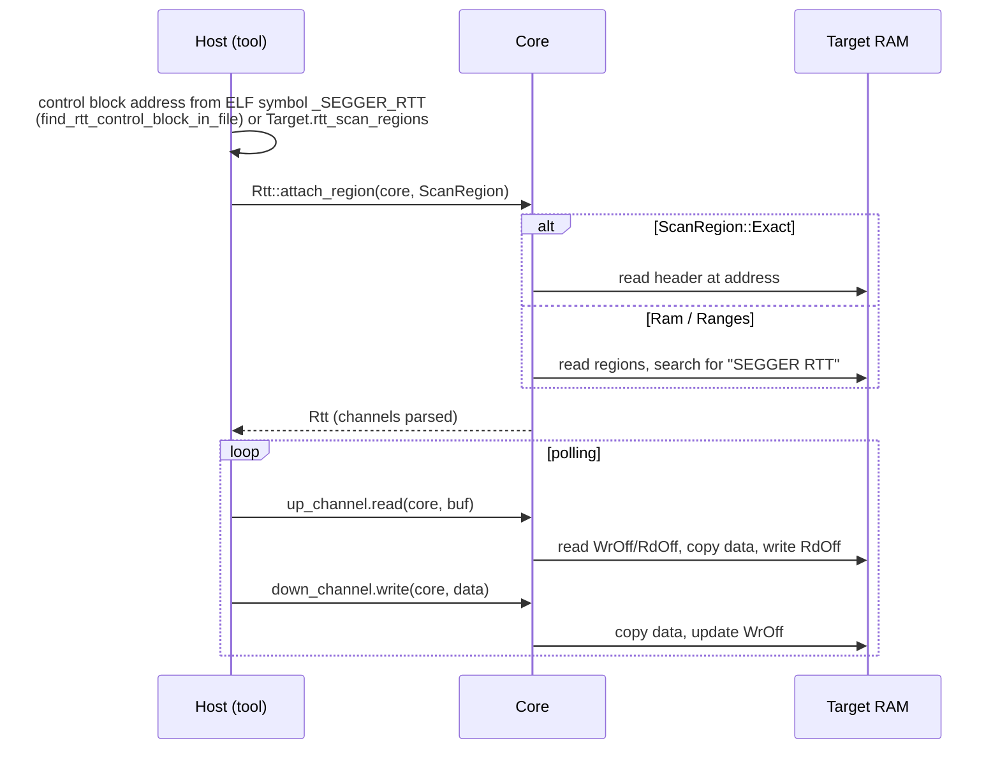
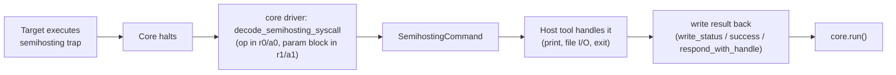
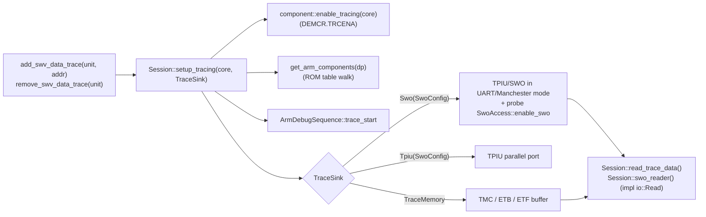

# 06 — RTT, semihosting, tracing and core dumps

Sources: [rtt.rs](../../src/rtt.rs), [rtt/channel.rs](../../src/rtt/channel.rs),
[semihosting.rs](../../src/semihosting.rs),
[architecture/arm/component/](../../src/architecture/arm/component/mod.rs),
[architecture/arm/swo/](../../src/architecture/arm/swo/mod.rs),
[core/dump.rs](../../src/core/dump.rs).

These features are built **on top of** the `Core` / `Session` API — they only use
memory access, register access and run control, so they work for every
architecture unless noted otherwise.

## 1. RTT (SEGGER Real-Time Transfer)

RTT uses a control block in target RAM (magic `"SEGGER RTT"`) containing ring
buffers. The host polls/updates the read/write pointers through the debug
interface while the target keeps running.

`try_attach_to_rtt` / `try_attach_to_rtt_shared` retry attachment with a timeout
(the control block may only be initialised after the firmware starts). The flash
loader re-uses RTT to stream log output from flash algorithms
(see [05-flashing.md](./05-flashing.md)).

## 2. Semihosting

When target code executes a semihosting trap (`BKPT 0xAB` on ARM, the
`slli x0,x0,0x1f / ebreak / srai x0,x0,7` sequence on RISC-V, `BREAK 1,14` on Xtensa), the core halts.
The core driver detects this and reports
`CoreStatus::Halted(HaltReason::Breakpoint(BreakpointCause::Semihosting(cmd)))`.

Supported `SemihostingCommand` variants: `ExitSuccess`, `ExitError`,
`GetCommandLine`, `Open`, `Close`, `WriteConsole`, `Write`, `Read`, `Seek`,
`FileLength`, `Remove`, `Rename`, `Time`, `Errno`, and `Unknown` (forwarded to
`*DebugSequence::on_unknown_semihosting_command` so vendors can handle custom ops).

## 3. ARM tracing (SWO / ITM / DWT / TPIU / ETB)

Components live in [component/](../../src/architecture/arm/component/mod.rs):
`Dwt`, `Itm`, `Tpiu`, `Swo`, `TraceMemoryController` (TMC), `TraceFunnel`, `Scs`.

## 4. Core dumps (feature `coredump`)

`CoreDump::dump_core(&mut core, ranges)` captures:

* all registers (`HashMap<RegisterId, RegisterValue>`),
* memory ranges (`Vec<(Range<u64>, Vec<u8>)>`),
* `instruction_set`, `core_type`, `fpu_support`, FP register count,
  64-bit access support.

`store(path)` / `load(path)` / `load_raw(bytes)` serialise it with MessagePack
(`rmp-serde`). A loaded `CoreDump` can act as a read-only core for
`probe-rs-debug` (stack traces / variable inspection offline).
