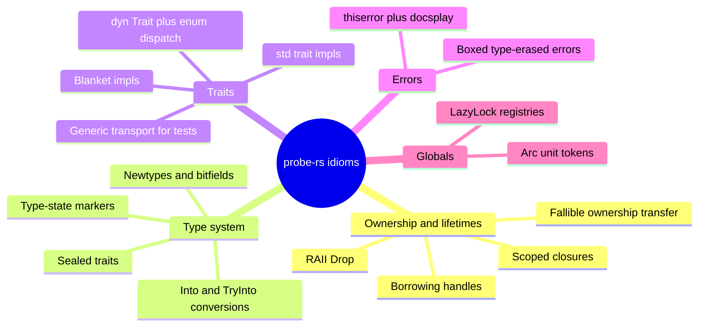
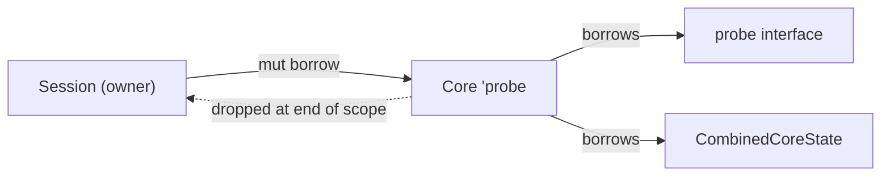
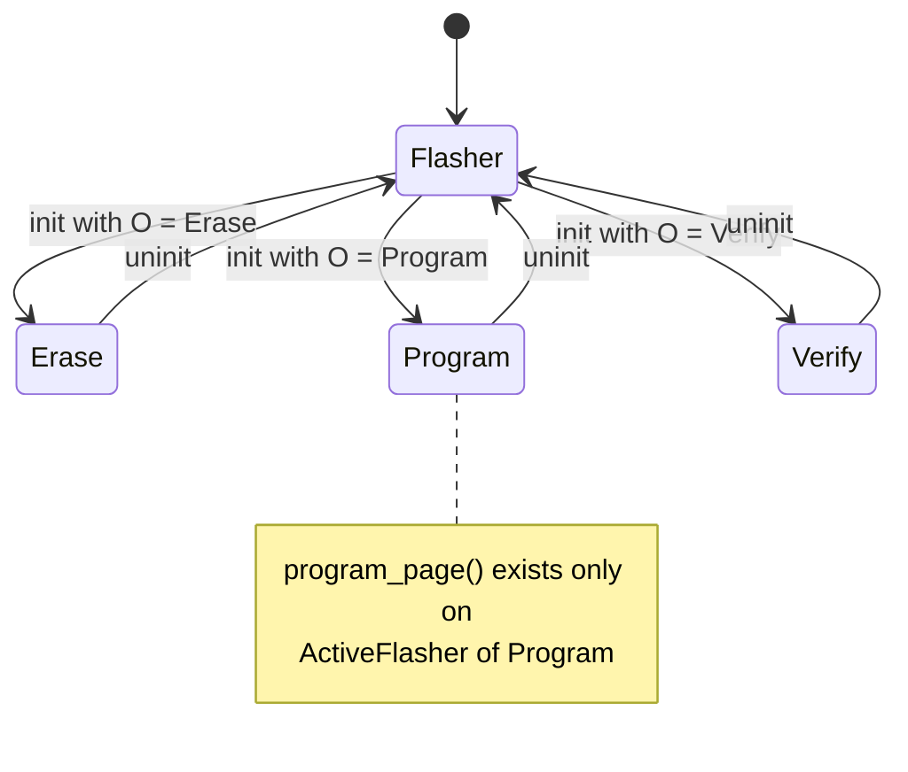
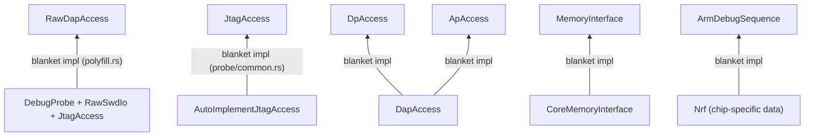
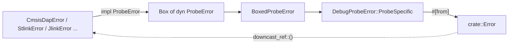
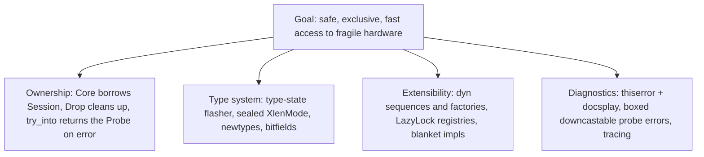

# 07 — Idiomatic Rust patterns in probe-rs

This document walks through Rust patterns that recur in the `probe-rs` crate.
Each section explains the pattern, shows a short excerpt from the code (trimmed
for brevity), and explains why it fits this domain.

| # | Pattern | Where |
|---|---|---|
| 1 | [Borrowing handles with lifetimes](#1-borrowing-handles-tied-to-an-owner-coreprobe) | `Core<'probe>`, `SwoReader<'a>` |
| 2 | [Type-state with zero-sized markers](#2-type-state-with-zero-sized-marker-types) | `ActiveFlasher<O: Operation>` |
| 3 | [Scoped resource via closure](#3-scoped-resources-via-closures-init--f--uninit) | `Flasher::run_erase/run_program/run_verify` |
| 4 | [Sealed traits + generic over marker](#4-sealed-traits-and-generic-code-over-marker-types) | `XlenMode`, `RiscvCore<X>` |
| 5 | [Blanket implementations](#5-blanket-implementations-implement-once-get-many) | `DpAccess`, `ApAccess`, `MemoryInterface`, `ArmDebugSequence for T: Nrf` |
| 6 | [Trait objects + enum dispatch](#6-trait-objects-and-enum-dispatch-side-by-side) | `DebugSequence`, `SpecificCoreState`, `Box<dyn CoreInterface>` |
| 7 | [Error handling with `thiserror` + `docsplay`](#7-error-handling-thiserror--docsplay--boxed-type-erased-errors) | `DebugProbeError`, `BoxedProbeError` |
| 8 | [Fallible ownership transfer](#8-fallible-ownership-transfer-give-the-value-back-on-error) | `Probe::try_into_arm_debug_interface` |
| 9 | [RAII cleanup via `Drop`](#9-raii-cleanup-with-drop) | `Session`, probe drivers |
| 10 | [Newtypes and `bitfield!` registers](#10-newtypes-and-bitfield-register-types) | `RegisterId`, `Abort`, `DataSize` |
| 11 | [Ergonomic generic conversions](#11-ergonomic-generic-conversions-into--tryinto) | `Core::read_core_reg<T>` |
| 12 | [Lazy global registries](#12-lazy-global-registries) | `DRIVERS`, `BUILTIN_TARGETS` |
| 13 | [Unique tokens via `Arc<()>`](#13-unforgeable-tokens-with-arc) | `DeferredResultIndex` |
| 14 | [Implementing std traits](#14-implementing-standard-library-traits) | `impl io::Read for SwoReader`, `ImageReader` |
| 15 | [Dependency injection for testing](#15-generic-transport-for-testability) | `StLink<D: StLinkUsb>` |



---

## 1. Borrowing handles tied to an owner (`Core<'probe>`)

`Session` owns the probe, the target, and the per-core state. Instead of handing
out shared, reference-counted objects, `Session::core(n)` returns a short-lived
**handle** that mutably borrows the session:

```rust
// src/core.rs
pub struct Core<'probe> {
    id: usize,
    name: &'probe str,
    target: &'probe Target,
    inner: Box<dyn CoreInterface + 'probe>,
}
```



**Why it fits here:** a debug probe is a single physical channel. Because
`Core` borrows the session mutably, the borrow checker guarantees at compile
time that only one core handle can talk to the probe at once. This
removes the need for `Mutex`/`RefCell` and makes accidental interleaving of
register accesses impossible. The cached per-core state (`CombinedCoreState`)
lives in the session, so it survives each short-lived `Core` handle (see
[01-session-and-core.md](./01-session-and-core.md)).

`SwoReader<'a>` (wrapping `&'a mut dyn ArmDebugInterface`) follows the same
pattern.

## 2. Type-state with zero-sized marker types

A flash algorithm must be initialised for a specific operation (Erase = 1,
Program = 2, Verify = 3) and only the matching routines may be called.
`ActiveFlasher` encodes that operation **in the type**:

```rust
// src/flashing/flasher.rs
pub trait Operation {
    const OPERATION: u32;
    const NAME: &'static str;
}

pub struct Erase;
impl Operation for Erase { const OPERATION: u32 = 1; const NAME: &'static str = "Erase"; }

pub struct ActiveFlasher<'op, 'p, O: Operation> {
    pub(super) core: Core<'op>,
    /* ... */
    _operation: PhantomData<O>,
}

impl ActiveFlasher<'_, '_, Erase>   { /* erase_sector, erase_all, ... */ }
impl ActiveFlasher<'_, '_, Program> { /* program_page, ... */ }
```



* The marker structs are **zero-sized**, so they cost nothing at runtime.
* Associated `const`s carry the per-operation value that is passed to the
  algorithm's `Init(addr, clk, fnc)` routine. Each impl block supplies its own
  value without any runtime branching.
* Calling `program_page` on an erase-initialised flasher is a **compile
  error** rather than a firmware fault.

(The source carries a `// TODO: needs to be sealed` comment on `Operation`. See
pattern 4 for how sealing would be done.)

## 3. Scoped resources via closures (init → f → uninit)

Code outside the flasher never creates an `ActiveFlasher` directly. It passes
a closure:

```rust
// src/flashing/flasher.rs
pub fn run_erase<'p, T, F>(&mut self, session: &mut Session,
                           progress: &mut FlashProgress<'p>, f: F) -> Result<T, FlashError>
where
    F: FnOnce(&mut ActiveFlasher<'_, 'p, Erase>, &mut [LoadedRegion]) -> Result<T, FlashError>,
{
    let (mut active, data) = self.init(session, progress, None)?;
    let r = f(&mut active, data)?;
    active.uninit()?;
    Ok(r)
}
```

This is the "with-resource" or "loan" pattern. The algorithm's `UnInit` routine
can fail and needs `&mut Session`, so it cannot run in a `Drop` impl. A
closure keeps setup and teardown together, and the `FnOnce` bound plus the
borrowed `&mut ActiveFlasher` ensure that the active flasher cannot escape the
scope. The generic `T` lets callers return any result from inside the scope.

## 4. Sealed traits and generic code over marker types

RV32 and RV64 cores differ only in a few details (XLEN, register file, core
type). Instead of two copies of the core driver, probe-rs has **one generic
struct** parameterised by a sealed marker trait:

```rust
// src/architecture/riscv/mod.rs
mod sealed { pub trait Sealed {} }

pub trait XlenMode: sealed::Sealed + 'static {
    fn configure_interface(interface: &mut RiscvCommunicationInterface);
    fn core_type() -> CoreType;
    /* ... */
}

pub struct Xlen32;
pub struct Xlen64;
impl sealed::Sealed for Xlen32 {}
impl sealed::Sealed for Xlen64 {}

pub struct RiscvCore<'state, X: XlenMode> { /* ... */ }
pub type Riscv32<'state> = RiscvCore<'state, Xlen32>;
pub type Riscv64<'state> = RiscvCore<'state, Xlen64>;
```

* `sealed::Sealed` is public but sits in a private module, so downstream
  crates **can name** `XlenMode` but **cannot implement** it. The set of
  variants stays closed, and new trait methods can be added without a breaking
  change.
* Static dispatch through `X: XlenMode` monomorphises into two specialised
  copies with no virtual calls.
* The type aliases `Riscv32`/`Riscv64` keep the public API simple.

## 5. Blanket implementations: implement once, get many

probe-rs builds higher-level capabilities from lower-level ones with blanket
`impl<T> Trait for T where T: Lower`:

```rust
// src/architecture/arm/dp/mod.rs
impl<T: ?Sized + DapAccess> DpAccess for T { /* typed DP register access */ }

// src/architecture/arm/ap/mod.rs
impl<T: DapAccess> ApAccess for T { /* typed AP register access */ }

// src/memory/mod.rs
impl<T> MemoryInterface<Error> for T
where
    T: CoreMemoryInterface,
    Error: From<<T as CoreMemoryInterface>::ErrorType>,
{
    fn read_word_32(&mut self, address: u64) -> Result<u32, Error> {
        self.memory_mut().read_word_32(address).map_err(Error::from)
    }
    /* ... */
}

// src/vendor/nordicsemi/sequences/nrf.rs
impl<T: Nrf> ArmDebugSequence for T { /* shared nRF unlock/erase logic */ }
```



Notable details:

* `?Sized` on `DpAccess` makes it work for `dyn DapAccess` trait objects too.
* The `MemoryInterface` blanket impl uses an **error-conversion bound**
  (`Error: From<T::ErrorType>`). Architecture-specific memory errors such as
  `ArmError` are converted to the crate-wide `Error` automatically via `?`/`map_err`.
* `impl<T: Nrf> ArmDebugSequence` is a "trait as data provider" pattern. Each
  nRF family implements a small `Nrf` trait (which APs belong to which core,
  and so on), and the full debug-sequence behaviour is written once.

## 6. Trait objects and enum dispatch, side by side

probe-rs uses both dispatch styles deliberately:

| Situation | Choice | Example |
|---|---|---|
| Open set, vendors/plugins can add implementations | `dyn Trait` (often `Arc<dyn …>`) | `Arc<dyn ArmDebugSequence>`, `&'static dyn ProbeFactory`, `Box<dyn DebugProbe>` |
| Closed set, known at compile time | `enum` | `ArchitectureInterface`, `SpecificCoreState`, `CoreStatus` |
| Combination of the two | enum of trait objects | `DebugSequence` |

```rust
// src/config/target.rs
pub enum DebugSequence {
    Arm(Arc<dyn ArmDebugSequence>),
    Riscv(Arc<dyn RiscvDebugSequence>),
    Xtensa(Arc<dyn XtensaDebugSequence>),
}
```

The outer `enum` is closed (three architectures), so `match` is exhaustive. The
inner `Arc<dyn …>` is open, so every vendor supplies its own sequence type, and
`Arc` lets the same sequence be shared by the `Target`, the session, and
every core without cloning. Default trait-method bodies (for example
`ArmDebugSequence::reset_system`) work like a "template method" pattern: a
vendor overrides only the hooks it needs.

## 7. Error handling: `thiserror` + `docsplay` + boxed type-erased errors

The crate defines layered error enums (`Error` → `ArmError`/`RiscvError`/
`XtensaError`/`DebugProbeError`/`FlashError`). They are derived with
`thiserror`, and their messages come from **doc comments** via
`docsplay::Display` (used in 37 places):

```rust
// src/probe.rs
#[derive(thiserror::Error, Debug, docsplay::Display)]
pub enum DebugProbeError {
    /// USB Communication Error
    Usb(#[source] std::io::Error),

    /// The debug probe could not be created.
    ProbeCouldNotBeCreated(#[from] ProbeCreationError),

    /// The probe does not support the {0} protocol.
    UnsupportedProtocol(WireProtocol),
    /* ... */
}
```

Each doc comment both documents the variant and produces its `Display` text,
so the two cannot drift apart. `#[from]` (48 uses) makes `?` lift lower-level
errors into higher-level ones.

Driver-specific errors are **type-erased** so the public enum does not need to
know every driver, yet callers can still recover the concrete type:

```rust
pub trait ProbeError: std::error::Error + Send + Sync + std::any::Any {}

#[derive(Debug, thiserror::Error)]
#[error(transparent)]
pub struct BoxedProbeError(#[from] Box<dyn ProbeError>);

impl BoxedProbeError {
    pub fn is<T: ProbeError>(&self) -> bool { self.as_any().is::<T>() }
    pub fn downcast_ref<T: ProbeError>(&self) -> Option<&T> { self.as_any().downcast_ref() }
}
```



## 8. Fallible ownership transfer: give the value back on error

Converting a `Probe` into an ARM interface consumes the probe. If the
conversion fails, the caller should not lose the (expensive, exclusively
owned) USB device, so the error returns it:

```rust
// src/probe.rs
pub fn try_into_arm_debug_interface<'probe>(
    self,
    sequence: Arc<dyn ArmDebugSequence>,
) -> Result<Box<dyn ArmDebugInterface + 'probe>, (Self, ArmError)>
```

The standard library uses the same approach (for example
`String::from_utf8` → `FromUtf8Error::into_bytes`, or `Rc::try_unwrap`). The
auto-detection code relies on this to try ARM first and then fall back to
RISC-V/Xtensa on the same probe (see
[04-targets-vendors-plugins.md](./04-targets-vendors-plugins.md)).

## 9. RAII cleanup with `Drop`

Hardware must be left in a sane state even when the user's code returns early
or panics. `Session` and several drivers (`CmsisDap`, `JLink`, `StLink<D>`,
`ArmCommunicationInterface`) implement `Drop`:

```rust
// src/session.rs
impl Drop for Session {
    #[tracing::instrument(name = "session_drop", skip(self))]
    fn drop(&mut self) {
        if let Err(err) = self.clear_all_hw_breakpoints() {
            tracing::warn!("Could not clear all hardware breakpoints: {:?}", anyhow::anyhow!(err));
        }
        if let Err(err) = { 0..self.cores.len() }.try_for_each(|core| match self.core(core) {
            Ok(mut core) => core.debug_core_stop(),
            Err(Error::CoreDisabled(_)) => Ok(()),
            Err(err) => Err(err),
        }) {
            tracing::warn!("Failed to deconfigure device during shutdown: {:?}", err);
        }
    }
}
```

`Drop` cannot return errors, so failures are **logged rather than propagated
or panicked on**. `try_for_each` stops at the first real error but
deliberately treats `CoreDisabled` as success.

## 10. Newtypes and `bitfield!` register types

Raw integers are wrapped in single-field types, so a register number cannot be
mixed up with an address or a value:

```rust
// src/core/registers.rs
#[derive(Debug, Copy, Clone, PartialEq, PartialOrd, Ord, Eq, Hash, Serialize, Deserialize)]
#[serde(transparent)]
pub struct RegisterId(pub u16);
```

`#[serde(transparent)]` keeps the serialised form a plain number (used by
`CoreDump`). Other examples: `RdBuff(u32)`, `ProgramCounter(u32)`, and the
`DpAddress`/`ApAddress` types.

Hardware registers are modelled with the `bitfield!` macro (65 definitions).
It generates typed getters and setters straight from the ARM/RISC-V specs, and
a companion macro attaches the register address and version metadata:

```rust
// src/architecture/arm/dp/mod.rs
bitfield! {
    #[derive(Copy, Clone, Default)]
    pub struct Abort(u32);
    impl Debug;
    pub _, set_orunerrclr: 4;
    pub _, set_wderrclr: 3;
    pub _, set_stkerrclr: 2;
    pub _, set_stkcmpclr: 1;
    pub _, set_dapabort: 0;
}
impl_dpregister!(Abort, DebugPortVersion::DPv1, 0x0, "ABORT");
```

Fallible decoding from raw values uses `TryFrom` (`DataSize: TryFrom<u8>`,
`ChannelMode: TryFrom<u64>`, Xtensa `Register: TryFrom<RegisterId>`).

## 11. Ergonomic generic conversions (`Into` / `TryInto`)

```rust
// src/core.rs
pub fn read_core_reg<T>(&mut self, address: impl Into<RegisterId>) -> Result<T, Error>
where
    RegisterValue: TryInto<T>,
    Result<T, <RegisterValue as TryInto<T>>::Error>: RegisterValueResultExt<T>,
{ /* ... */ }

pub fn write_core_reg<T>(&mut self, address: impl Into<RegisterId>, value: T) -> Result<(), Error>
where
    T: Into<RegisterValue>,
{ /* ... */ }
```

* `impl Into<RegisterId>` accepts a `RegisterId`, a `&CoreRegister`, or other
  convertible descriptions.
* The return type is chosen by the caller: `let pc: u32 = core.read_core_reg(pc_id)?;`.
  A register that is too wide for `T` is an error, not a silent truncation.
* `RegisterValueResultExt` is an **extension trait** that maps the conversion
  error into `crate::Error`, so the bound works for every `T`.

## 12. Lazy global registries

Plugin-style registries are global, lazily initialised and mutable at runtime:

```rust
// src/probe.rs
static DRIVERS: LazyLock<RwLock<Vec<&'static dyn ProbeFactory>>> = LazyLock::new(|| {
    let probes: Vec<&'static dyn ProbeFactory> = vec![
        &blackmagic::BlackMagicProbeFactory,
        &cmsisdap::CmsisDapFactory,
        /* ... */
    ];
    RwLock::new(probes)
});

// src/config/registry.rs
static BUILTIN_TARGETS: LazyLock<RwLock<Vec<ChipFamily>>> =
    LazyLock::new(|| RwLock::new(builtin_targets()));
```

* `std::sync::LazyLock` (stable since Rust 1.80) replaces `lazy_static!`/`once_cell`.
* Factories are **unit structs stored as `&'static dyn ProbeFactory`**, which
  needs no allocation or `Box`. The registry stores references to `static`
  zero-sized values.
* The `RwLock` allows registering extra entries at runtime: the plugin system
  uses the crate-internal `register_probe_factory`/`register_vendor`, and
  applications can call the public `add_builtin_target`.
* The register tables (`RISCV_CORE_REGISTERS`, `XTENSA_CORE_REGISTERS`) combine
  `&'static [CoreRegister]` slices built at compile time with a `LazyLock` for
  the assembled set.

## 13. Unforgeable tokens with `Arc<()>`

The JTAG command queue returns a handle per deferred command and later resolves
results by handle:

```rust
// src/probe/queue.rs
#[derive(Eq)]
pub struct DeferredResultIndex(Arc<()>);

impl PartialEq for DeferredResultIndex {
    fn eq(&self, other: &Self) -> bool { Arc::ptr_eq(&self.0, &other.0) }
}

pub struct DeferredResultSet<T>(HashMap<DeferredResultIndex, T>);
impl<T> DeferredResultSet<T> {
    pub fn take(&mut self, index: DeferredResultIndex) -> Result<T, DeferredResultIndex> {
        self.0.remove(&index).ok_or(index)
    }
}
```

* Identity is based on the **allocation address** (`Arc::ptr_eq`), so indices
  are unique without a global counter and cannot be forged from an integer.
* `should_capture()` checks `Arc::strong_count > 1`. If the caller dropped
  its index, the queue knows that nobody will read the result and discards it
  (`retain(|k, _| k.should_capture())`).
* `Clone` is intentionally private, so user code cannot duplicate a token.
* `take` consumes the index and **returns it on failure** (pattern 8 again).

## 14. Implementing standard-library traits

Implementing `std` traits lets probe-rs types plug into the wider ecosystem:

```rust
// src/architecture/arm/swo/mod.rs
impl std::io::Read for SwoReader<'_> {
    fn read(&mut self, buf: &mut [u8]) -> std::io::Result<usize> {
        self.buf.append(&mut self.interface.read_swo().map_err(Error::other)?);
        /* ... copy into buf ... */
    }
}

// src/flashing/loader.rs
pub trait ImageReader: Read + Seek {}
impl<T> ImageReader for T where T: Read + Seek {}
```

* `SwoReader` can be wrapped in `BufReader` or passed to `std::io::copy`,
  just like any ITM decoder that accepts `impl Read`.
* `ImageReader` is a **trait alias** built from a blanket impl: it lets the
  code write `&mut dyn ImageReader` (a `dyn Read + Seek` is not otherwise
  expressible), while every `File`, `Cursor<Vec<u8>>`, and so on qualifies
  automatically.

## 15. Generic transport for testability

The ST-Link driver is generic over its USB layer:

```rust
// src/probe/stlink/usb_interface.rs
pub trait StLinkUsb: std::fmt::Debug { /* write/read/reset ... */ }
impl StLinkUsb for StLinkUsbDevice { /* real nusb device */ }

// src/probe/stlink/mod.rs  (tests)
impl StLinkUsb for MockUsb { /* scripted responses */ }
```

`StLink<D: StLinkUsb>` runs the real protocol logic against a `MockUsb` in
unit tests, so no hardware is needed. In production it is monomorphised for
`StLinkUsbDevice`, so the abstraction costs nothing at runtime.

---

## Summary



Taken together, these patterns move invariants such as "one core at a time",
"only program after init for Program" and "do not lose the probe" from runtime
checks and documentation into the **compiler**. That matters most in a
debugger, where a mistake can brick a chip instead of just crashing the program.
