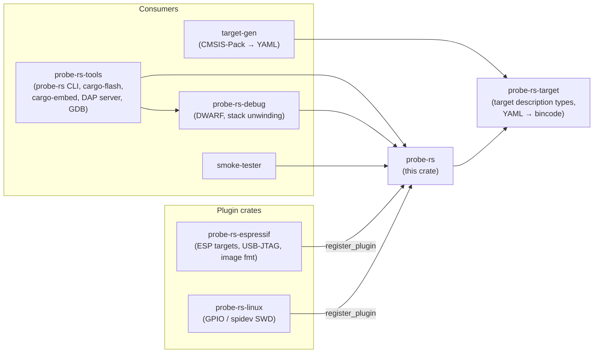
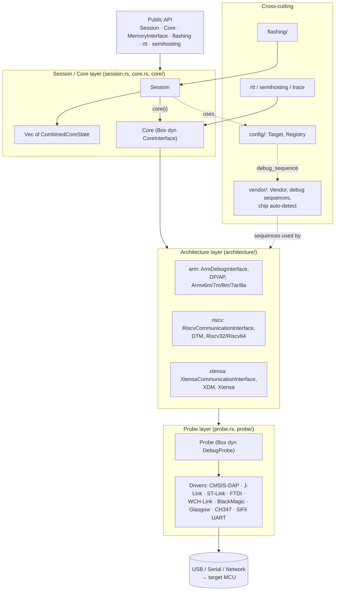
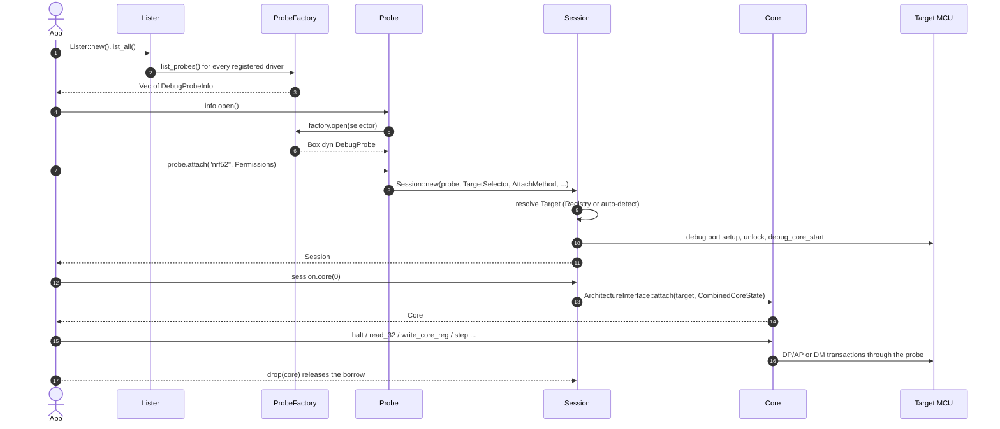

# probe-rs crate — Architecture Overview

This folder documents the internal architecture of the `probe-rs` library crate
(`probe-rs/` in the workspace, ~80k lines of Rust). It was produced by analysing
the source with rust-analyzer, a code-graph index, and manual reading.

| Document | Content |
|---|---|
| [README.md](./README.md) | Big picture, layers, module map, workspace context |
| [01-session-and-core.md](./01-session-and-core.md) | `Session`, `Core`, `CombinedCoreState`, attach lifecycle |
| [02-probe-layer.md](./02-probe-layer.md) | Probe drivers, `DebugProbe`, factories, wire protocols |
| [03-architecture-layer.md](./03-architecture-layer.md) | ARM (ADI), RISC-V, Xtensa debug interfaces and cores |
| [04-targets-vendors-plugins.md](./04-targets-vendors-plugins.md) | Target descriptions, `Registry`, vendor debug sequences, auto-detection, plugins |
| [05-flashing.md](./05-flashing.md) | Flash loader, flash algorithms, erase/program/verify pipeline |
| [06-rtt-semihosting-trace.md](./06-rtt-semihosting-trace.md) | RTT, semihosting, SWO / trace, core dumps |
| [07-rust-idioms.md](./07-rust-idioms.md) | Idiomatic Rust patterns used across the crate (type-state, sealed traits, blanket impls, RAII, error design, ...) |

---

## 1. Purpose

`probe-rs` is a host-side library that talks to embedded microcontrollers through
a **debug probe** (J-Link, ST-Link, CMSIS-DAP, FTDI, WCH-Link, ...). It provides:

* Probe discovery and opening
* Connecting to a chip over **SWD** or **JTAG**
* Controlling cores (halt / run / step / reset / breakpoints / registers)
* Reading and writing target memory
* Programming flash (ELF, HEX, BIN, UF2; more formats via plugins)
* Real-Time Transfer (RTT), semihosting, SWO/ITM tracing, core dumps

The crate docs ([src/lib.rs](../../src/lib.rs)) say it is built around four main
abstractions: **`Probe`**, **`Target`**, **`Session`** and **`Core`**.

## 2. Workspace context

## 3. Layered architecture

**Key idea:** the probe driver is *moved into* the architecture interface, which is
*owned by* the `Session`. A `Core` is a short-lived *borrowing view* that combines
the architecture interface with the per-core cached state.

## 4. Module map

| Module | Visibility | Responsibility |
|---|---|---|
| [session.rs](../../src/session.rs) | `pub use` | `Session`, `SessionConfig`, `Permissions`, attach logic |
| [core.rs](../../src/core.rs), [core/](../../src/core/) | re-exported | `CoreInterface` trait, `Core` wrapper, core state, registers, status, `CoreDump` |
| [memory/](../../src/memory/mod.rs) | re-exported | `MemoryInterface` (8/16/32/64-bit reads/writes), `CoreMemoryInterface` |
| [probe.rs](../../src/probe.rs), [probe/](../../src/probe/) | `pub` | `Probe`, `DebugProbe`, `ProbeFactory`, `Lister`, JTAG/SWD bit-level traits, all drivers |
| [architecture/arm](../../src/architecture/arm/mod.rs) | `pub` | ADIv5/v6 DP/AP, memory APs, ROM tables, CoreSight components, SWO, Cortex-M/A/R cores, `ArmDebugSequence` |
| [architecture/riscv](../../src/architecture/riscv/mod.rs) | `pub` | RISC-V debug module, DTM over JTAG or mem-AP, `RiscvDebugSequence` |
| [architecture/xtensa](../../src/architecture/xtensa/mod.rs) | `pub` | Xtensa XDM/NAR access, `XtensaDebugSequence` |
| [config/](../../src/config/mod.rs) | `pub` | `Target`, `TargetSelector`, `Registry`, `DebugSequence` |
| [vendor/](../../src/vendor/mod.rs) | `pub` | `Vendor` trait + 16 vendor modules with custom sequences and chip detection |
| [flashing/](../../src/flashing/mod.rs) | `pub` | `FlashLoader`, `Flasher`, `FlashAlgorithm`, image formats, progress |
| [rtt.rs](../../src/rtt.rs) | `pub` | SEGGER RTT control-block discovery and channels |
| [semihosting.rs](../../src/semihosting.rs) | `pub` | Semihosting command decoding |
| [plugin.rs](../../src/plugin.rs) | `pub` | `Plugin` / `register_plugin` extension point |
| [integration.rs](../../src/integration.rs) | `pub` | Helpers for integration tests in downstream apps |
| [error.rs](../../src/error.rs) | re-exported | Top-level `Error` enum |
| [build.rs](../../build.rs) | build | Compiles `targets/*.yaml` (~240 families) into `targets.bincode` |

## 5. End-to-end usage flow

## 6. Design principles observed in the code

* **Trait-object driven extensibility** – probes (`DebugProbe`, `ProbeFactory`),
  cores (`CoreInterface`), chip-specific behaviour (`ArmDebugSequence`,
  `RiscvDebugSequence`, `XtensaDebugSequence`), vendors (`Vendor`) and image formats
  (`ImageFormat`) are `dyn` traits, several held in global
  `LazyLock<RwLock<Vec<...>>>` registries that plugins can extend.
* **Capability discovery via `try_*`** – `DebugProbe::try_get_arm_debug_interface`,
  `try_as_jtag_probe`, `try_get_riscv_interface_builder`, `try_as_dap_probe` let
  generic code ask a probe what it can do instead of relying on a fixed type hierarchy.
* **Blanket "polyfill" impls** – any probe implementing `DebugProbe + RawSwdIo + JtagAccess`
  automatically gets `RawDapAccess` ([traits/polyfill.rs](../../src/architecture/arm/traits/polyfill.rs)),
  so bit-banging probes need not implement ADI transfers themselves.
* **State outside, behaviour inside** – long-lived per-core state lives in
  `CombinedCoreState` inside the `Session`; the `Core<'probe>` handle is cheap and
  re-created for every operation.
* **Data-driven targets** – chips are YAML (mostly CMSIS-Pack-derived) descriptions
  compiled into the binary; code is only needed for non-standard sequences.
* **Explicit permissions** – destructive operations (e.g. mass-erase to unlock)
  require `Permissions::allow_erase_all()`.
